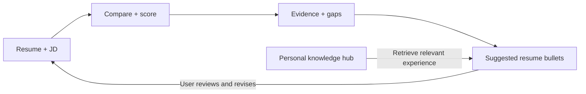

# RoleMatch roadmap

## Goal

Help job seekers understand how their resume matches a role and improve it using experience they can substantiate.

## Completed

- [x] Read PDFs, Word documents (DOCX), and plain-text JDs.
- [x] Extract structured resume and job information, including required and preferred qualifications.
- [x] Save extractions and reuse valid results instead of repeating work.
- [x] Process document folders with visible CLI progress.
- [x] Build requirement-level matching with evidence and coverage checks; verified with mocked tests.
- [x] Build and commit a separate frontend prototype: comparison board, uploads, filters, and an evidence inspector.

The frontend is on `frontend` and uses sample data. Matching exists on `main` but is not connected to the CLI yet.

## Scoring — implemented

- [x] Calculate a score from the requirement assessments.
- [x] Apply explicit required/preferred weights and return earned and possible points.
- [x] Verify full, partial, missing-evidence, and empty-input cases.

The scorer returns a percentage rounded to two decimals, or no score when there are no assessments.

## Next milestones

### 1. Complete the comparison workflow — next

- [ ] Try matching with real resumes and JDs and inspect the evidence.
- [ ] Connect extraction, matching, and scoring for one pair, then multiple pairs.
- [ ] Save comparison reports with requirement-level and required/preferred score breakdowns; reuse results when appropriate.
- [ ] Keep requirement references clear and avoid counting the same condition twice.

### 2. Connect the frontend

- [ ] Finalize the UI direction.
- [ ] Connect uploads, comparisons, processing progress, and real results.
- [ ] Show score breakdowns, evidence, gaps, and downloadable reports.
- [ ] Check the complete workflow on desktop and mobile.

### 3. Build the personal knowledge hub

- [ ] Let users add notes and documents about their work, projects, and achievements.
- [ ] Preserve sources, dates, contributions, and supported outcomes.
- [ ] Let users review, correct, and delete their information.

### 4. Suggest improvements using RAG

- [ ] Retrieve hub entries relevant to gaps in a target JD.
- [ ] Suggest resume bullets with supporting source references.
- [ ] Preserve facts and qualifiers; ask for missing details rather than inventing them.
- [ ] Let users accept, edit, or reject suggestions and keep resume versions.
- [ ] Reassess the revised resume after changes are adopted.

Hub evidence and the current resume's score stay separate until the resume is revised.

### 5. Measure and improve quality — deferred for now

- [ ] Create manually reviewed extraction, matching, retrieval, and suggestion examples.
- [ ] Compare approaches and track accuracy, unsupported claims, speed, and cost.
- [ ] Check that changes improve results on examples not used during development.

### 6. Make it reliable and release it

- [ ] Handle failures, rate limits, retries, and interrupted batches.
- [ ] Refresh saved results when processing rules or source information change.
- [ ] Add user accounts, private storage, and deletion controls for the hosted knowledge hub.
- [ ] Automate checks, deploy the application, and document setup and limitations.

## Optional later

- [ ] Scanned-document reading, legacy DOC support, and more complex document layouts.
- [ ] Richer profiles and retrieval improvements when real examples demonstrate the need.

Update this checklist as work changes. Mark prototypes separately from integrated features, and check items only after implementation and verification.
